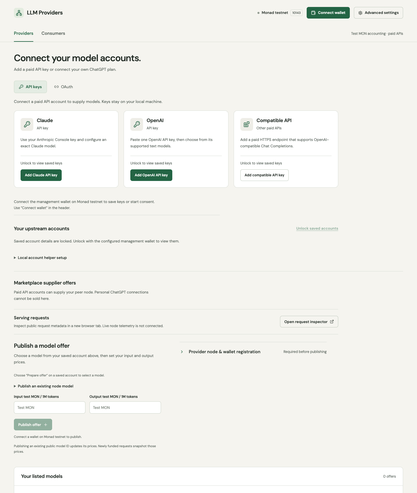
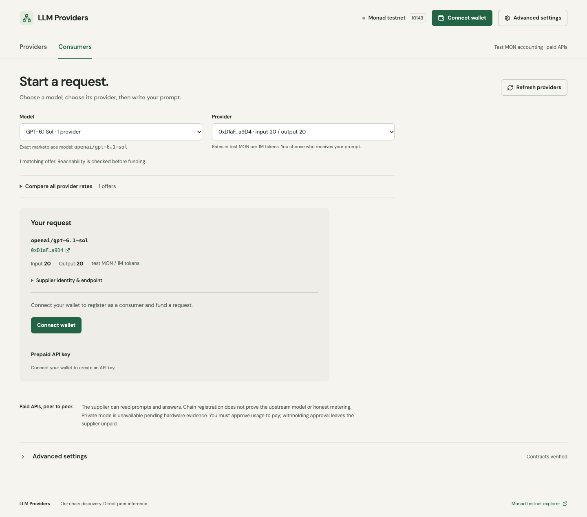
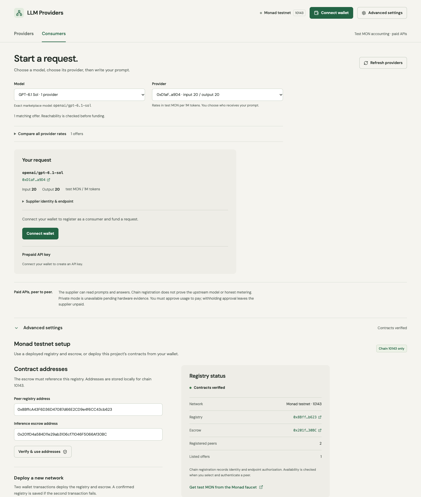
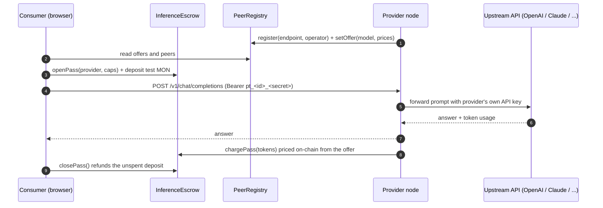

<div align="center">

# LLM Providers

**A peer-to-peer marketplace for paid LLM APIs, settled on Monad.**

Providers list the models they can serve and set their own prices. Consumers pick a provider, prepay on-chain, and call it from any OpenAI-compatible client. No middleman holds the keys or the money.


</div>

---

## Built for Monad Blitz Pune V3

This project was built for the **Monad Blitz Pune V3** hackathon. It is a testnet prototype. All value is test MON on Monad testnet (chain ID `10143`), and nothing here touches mainnet.

## The idea

Paid model APIs have prepaid credit, discounts and spare capacity that go unused. People who need a model have no direct way to buy that capacity. This app connects the two sides with a thin on-chain layer:

- **Providers** register a node, connect their own API keys locally, and publish `model + input price + output price` offers on-chain.
- **Consumers** browse the offers, compare prices, and choose a provider themselves. Nothing is auto-routed.
- **Payment** is held in an escrow contract. A request is funded up front, the provider's node meters real token usage, and the contract pays out only what was used. The rest is refunded.
- **Prepaid API keys** make this usable from existing tools. Deposit once, get an OpenAI-compatible base URL and key, and call the provider with no wallet approval per request.

## Screenshots

### Providers: connect accounts and publish offers

Keys stay on the provider's machine. They are saved through a local wallet-authenticated helper and are never sent to peers or the browser.



### Consumers: pick a model, pick a provider

Offers are read straight from the on-chain registry. The model list shows how many providers serve each model, and rates are in test MON per 1M tokens.



### Advanced settings: contracts and registry status

Verify, reuse or deploy the registry and escrow contracts from your own wallet.



## How it works



There are two ways to pay, and both go through the same escrow:

| | Funded request | Prepaid API key |
|---|---|---|
| Wallet approval | Every request | Once, when the key is created |
| Client | The web app | Any OpenAI-compatible client or `curl` |
| Metering | Signed invoice the consumer approves | Node charges tokens at the offer's rates, inside caps the consumer set |
| Limits | Per-request budget and deadline | Deposit, per-call cap, expiry, and a 2x price ceiling |
| Refund | Unused budget returns as credit | `closePass` refunds the rest at any time |

### Components

| Path | What it is |
|---|---|
| `contracts/` | `PeerRegistry` (identities, endpoints, offers) and `InferenceEscrow` (funded requests, prepaid passes) |
| `src/web/` | React and Vite app with the Providers and Consumers tabs |
| `src/provider/` | Provider node: authenticates requests, calls the upstream API, meters tokens, serves `/v1/*` and `/stats` |
| `src/accounts/` | Local helper that stores upstream API keys on the provider's machine |
| `src/privacy/`, `attestation/` | Lit and zkDCAP privacy work. Code and tests only, **not live** (see [limitations](#limitations)) |
| `tests/`, `test/` | Node tests and Foundry tests |

## Deployed on Monad testnet

| Contract | Address |
|---|---|
| PeerRegistry | [`0x8BffcA43F6D36D47087d66E2CD9e4f6CC43cb623`](https://testnet.monadexplorer.com/address/0x8BffcA43F6D36D47087d66E2CD9e4f6CC43cb623) |
| InferenceEscrow | [`0x201fD4a584D11e29ab3106cF71046F5066Af30BC`](https://testnet.monadexplorer.com/address/0x201fD4a584D11e29ab3106cF71046F5066Af30BC) |

You can use these, or deploy your own in step 4 below.

## Setup

### Requirements

- **Node.js 22.12 or newer** and npm
- **[Foundry](https://book.getfoundry.sh/getting-started/installation)** (`forge`, and `anvil` for the integration test)
- A browser wallet (MetaMask, Rabby, ...) on **Monad testnet**
- Test MON from the [Monad faucet](https://faucet.monad.xyz) for every wallet you use
- For the provider role only: an API key for at least one upstream model provider

Add Monad testnet to your wallet if it isn't listed:

| Field | Value |
|---|---|
| Network name | Monad Testnet |
| RPC URL | `https://testnet-rpc.monad.xyz` |
| Chain ID | `10143` |
| Currency symbol | `MON` |
| Explorer | `https://testnet.monadexplorer.com` |

### 1. Install

```sh
git clone https://github.com/Jayesh1512/llm-providers.git
cd llm-providers
npm install
cp .env.example .env
npm run contracts:export
```

`contracts:export` compiles the Solidity contracts and writes the ABI and bytecode the app uses.

### 2. Start the app

```sh
npm run dev
```

Open http://127.0.0.1:5173. This starts the web app on port `5173` and the local account helper on `8791`.

The public RPC allows **15 requests per second per IP**. The app batches its reads to stay under that. If you still see `requests limited to 15/sec`, close extra tabs, or set your own RPC URL in `.env` (`MONAD_RPC_URL` and `VITE_MONAD_RPC_URL`).

### 3. Connect your wallet

Click **Connect wallet** and switch to Monad testnet. The header shows the network and chain ID.

### 4. Contracts: reuse or deploy

Use the addresses above, or deploy your own.

**Use the existing deployment.** Put these in `.env`, then restart `npm run dev`. Vite only reads `.env` at startup.

```dotenv
REGISTRY_ADDRESS=0x8BffcA43F6D36D47087d66E2CD9e4f6CC43cb623
ESCROW_ADDRESS=0x201fD4a584D11e29ab3106cF71046F5066Af30BC
VITE_REGISTRY_ADDRESS=0x8BffcA43F6D36D47087d66E2CD9e4f6CC43cb623
VITE_ESCROW_ADDRESS=0x201fD4a584D11e29ab3106cF71046F5066Af30BC
VITE_MONAD_RPC_URL=https://testnet-rpc.monad.xyz
```

**Deploy your own, from the app.** Leave the address variables empty, open **Advanced settings**, and click **Deploy a new network**. Confirm two wallet transactions (registry, then escrow). Copy the two addresses into `.env` as above so other browsers and wallets see them. If you set both addresses in `.env`, the deploy button is disabled on purpose.

**Deploy your own, from the CLI.** Set `DEPLOYER_PRIVATE_KEY` in `.env` (locally, never in chat or git), then run `npm run deploy:monad`. Afterwards run `npm run verify:monad -- <registry> <escrow>` to check the deployment read-only.

Once set, the header's Advanced settings shows **Contracts verified**.

### 5. Run as a provider

1. **Create a node key.** This is a separate signing key held only by your node. It is not your wallet.
   ```sh
   cast wallet new
   ```
   Note its address. This is your **node operator address**.
2. **Fill in `.env`** (your wallet is the listing owner, the node key is the operator):
   ```dotenv
   PROVIDER_ADDRESS=0xYourWalletAddress
   NODE_PRIVATE_KEY=0xYourNodeKey
   OPENAI_API_KEY=sk-...
   PROVIDER_MODELS_JSON='[{"model":"openai/my-model","apiKind":2,"upstreamModel":"EXACT_UPSTREAM_MODEL_ID","baseUrl":"https://api.openai.com","apiKeyEnv":"OPENAI_API_KEY"}]'
   ```
   `apiKind` is `1` for Anthropic Messages, `2` for OpenAI Responses and `3` for OpenAI-compatible Chat Completions. `model` is the marketplace ID consumers see. `upstreamModel` is the exact ID your upstream account serves.
3. **Fund the node key** with a little test MON. It pays gas to relay charges.
4. **Set the operator address in the app.** The app pins the node operator address as a hackathon simplification. Open `src/web/App.tsx` (line ~87) and replace the default in `useState('0x…')` with the address from step 1. Vite hot-reloads it. The registered operator must equal the address of `NODE_PRIVATE_KEY`, or consumers can't authenticate your node.
5. **Start the node:**
   ```sh
   npm run provider
   ```
   It listens on `127.0.0.1:8787` by default. Check `http://127.0.0.1:8787/health`.
6. **Register.** In the app, go to **Providers**, open **Provider node & wallet registration**, enter your node endpoint (`http://127.0.0.1:8787` for local use), and click **Register peer**. The checklist at the top of that section tracks your progress.
7. **Publish an offer.** Set an input and output price in test MON per 1M tokens and click **Publish offer**.

The **Providers** tab then shows a stats row: requests served, API key calls, and earnings. It reads your node's `/stats` endpoint and refreshes every 15 seconds.

> For a public endpoint, put HTTPS in front of the node and set `ALLOWED_ORIGINS` to your frontend's exact origin. To bind outside loopback, set `BIND_HOST=0.0.0.0`.

### 6. Use it as a consumer

**Use the app**

1. Open **Consumers** and connect a wallet. Use a different wallet from the provider to test the full flow.
2. Pick a model, then a provider. Rates are shown per 1M tokens.
3. Register the wallet as a consumer when prompted (one transaction).
4. Write a prompt, set a capped budget, and fund the request. Keep the page open until the response comes back. The prompt is not stored, so a refresh means you must retype the exact prompt to continue or recover the deposit after expiry.
5. Approve usage to settle. Unused budget returns as credit you can withdraw.

**Use a prepaid API key (works with any OpenAI-compatible client)**

1. Select a provider as above.
2. In **Prepaid API key**, set a deposit, a max per call, and a number of days, then click **Create API key** and confirm the transaction.
3. The key card shows the base URL, the key, and a ready-to-run `curl` command with your key filled in. Use **Copy curl command**.

```sh
curl http://127.0.0.1:8787/v1/chat/completions \
  -H "Authorization: Bearer pt_1_<your key>" \
  -H "Content-Type: application/json" \
  -d '{"model":"openai/my-model","messages":[{"role":"user","content":"Hello"}]}'
```

For SDKs, set the base URL to `http://127.0.0.1:8787/v1`, the API key to your full `pt_…` key, and the model to the marketplace ID. **Close key & refund unspent** revokes the key and returns the remaining deposit. Anyone holding the key can spend the remaining deposit, so treat it like cash.

A local endpoint is only reachable from your own machine. To call a provider from elsewhere, it needs an HTTPS tunnel or a public endpoint.

## Troubleshooting

| Symptom | Cause and fix |
|---|---|
| No providers listed | The app has no contract addresses. Set the `VITE_*` variables, restart `npm run dev`, and hard-refresh. The saved address in a browser's `localStorage` is a fallback only. |
| `requests limited to 15/sec` | Public RPC limit. Close extra tabs, wait a few seconds, or use a private RPC URL. |
| **Create API key** fails, empty revert | The deployed escrow predates prepaid keys. Deploy a fresh escrow from the current contracts. |
| "Connect the wallet that owns this local account helper" | The account helper is pinned to another wallet. Connect that wallet, or stop the app and delete `.account-state/` to re-pin (this deletes saved keys). |
| "Enter the original funded prompt" | The prompt box doesn't match the funded request's hash. Retype it exactly, or recover the deposit after the deadline. |
| `Supplier startup failed` | The previous node still holds the state lock, or config is wrong. Stop the other process and retry. After an unclean exit, remove only `.lock` in `.provider-state/`. |
| Deploy button is disabled | Both addresses are already set. Clear the unwanted one in `.env`, or run `localStorage.removeItem('llm-providers:contracts:10143')` in the browser console. |
| Node can't be authenticated | Registered operator doesn't equal the address of `NODE_PRIVATE_KEY`. Re-register with the correct operator. |

## Test

```sh
npm run test:contracts   # Foundry tests
npm test                 # unit tests
npm run test:e2e         # local Anvil chain, both contracts, all three API formats via fixtures
npm run build
```

The end-to-end test uses no live API credentials and deploys nothing public.

## Limitations

This is a prototype built in a hackathon. Read these before relying on it.

- **Testnet only.** Deployment tools reject mainnet. Test MON has no value.
- **Trust in the provider.** The chain doesn't prove which model answered or that token counts are honest. Providers can read prompts and responses.
- **Fair exchange is unsolved.** In the funded-request flow, a consumer can withhold payment approval after receiving an answer. Prepaid keys avoid this but make the consumer trust the provider's metering, bounded by the deposit, per-call cap and price ceiling.
- **Private mode is not live.** The Lit and on-chain attestation code is written and tested, but the hardware evidence it needs doesn't exist yet, so private registration and funding fail closed.
- **Stats start at restart.** API-key call counts begin from the node's first run with this feature. Earlier calls aren't counted.
- **Prices aren't promises.** Cheaper rates depend on a provider's own costs. The app promises no savings.

## More documentation

- [Full reference (operations, accounts, interface details)](docs/DETAILS.md)
- [Protocol](PROTOCOL.md) and [architecture](docs/ARCHITECTURE.md)
- [Account connectors and key storage](docs/ACCOUNT_CONNECTORS.md)
- [Privacy design](docs/PRIVACY.md) and [on-chain attestation](docs/ONCHAIN_ATTESTATION.md)
- [Third-party dependencies and licenses](docs/THIRD_PARTY.md). The linked RISC Zero verifier adds GPL-3.0 obligations for that combined deployment.
